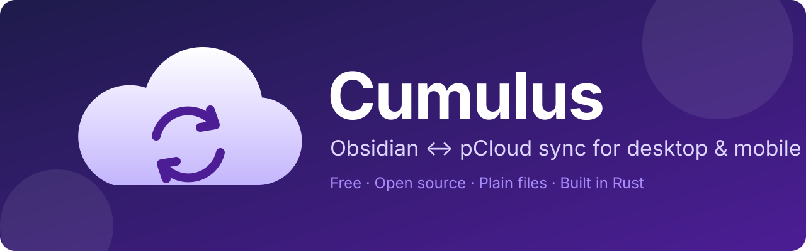

<p align="center">
  
</p>

# Cumulus: sync Obsidian with pCloud on Android, iOS and desktop

[](https://github.com/Q-sn/cumulus-sync/releases)
[](https://github.com/Q-sn/cumulus-sync/actions/workflows/ci.yml)
[](LICENSE)


Cumulus is a free, open source Obsidian plugin that keeps your vault in sync with a folder in pCloud. It was written for a common situation: the vault lives in pCloud and works fine on the computer through pCloud Drive, but Obsidian on the phone can't open it.

Cumulus keeps a local copy of the vault on the phone or tablet and syncs it with pCloud in both directions. Your notes stay ordinary Markdown files in your own pCloud account, so pCloud Drive, the pCloud web app and any other editor keep working with them.

> [!NOTE]
> The plugin is in active development and there is no release yet. ⭐ Star the repo or use *Watch → Custom → Releases* to get notified when the first beta is out.

## Features

**Two-way sync.** Changes made on the phone go up to pCloud. Changes made on the computer come down to the phone. Cumulus works out what changed on which side, so a sync never blindly overwrites one copy with the other.

**Built to keep your notes safe.** If a note was edited on one device and deleted on another, the edit wins. When the same note changes in two places, both versions are kept. Deleted files go to the trash, not straight into the void. If a sync is about to remove a large part of the vault, Cumulus stops and asks first.

**Fast on big vaults.** pCloud has a change feed, so Cumulus asks it "what changed since last time" instead of listing the whole vault on every run. Only changed files are transferred.

**Made for mobile.** Obsidian plugins can't run in the background on Android or iOS, so Cumulus syncs when you open the app, a few seconds after you stop typing, and right before you switch to another app. File transfers are kept small and sequential to stay within the memory limits of mobile Obsidian.

**Works alongside pCloud Drive.** The recommended setup is pCloud Drive on your computer and Cumulus on your phone. To Cumulus, pCloud Drive is just one more device writing to the same folder.

**EU and US accounts.** Your pCloud region is detected when you sign in.

**No middleman.** Your files go straight between Obsidian and pCloud. There are no servers of our own and no analytics.

## How Obsidian pCloud sync works

1. Sign in to pCloud from the plugin settings. This happens on pCloud's own page, and Cumulus never sees your password.
2. Choose the folder in pCloud that contains your vault.
3. That's it. The first sync starts right away and from then on runs on its own while Obsidian is open. A new phone simply gets the vault from pCloud; if both sides already have files, matching ones are recognised and differing ones are kept in both versions.

Under the hood, Cumulus records the state of every file after each successful sync. On the next run it compares the phone and pCloud against that record rather than against each other. That's how it can tell an edit from a deletion, and a real conflict from a timestamp that drifted, which happens a lot on Android.

## Installation

Cumulus isn't in the Obsidian community plugin directory yet. Once the beta is out, you can install it with [BRAT](https://github.com/TfTHacker/obsidian42-brat):

1. Install BRAT from *Settings → Community plugins*.
2. In BRAT, choose *Add beta plugin* and enter `Q-sn/cumulus-sync`.
3. Enable Cumulus and connect your pCloud account in its settings.

The plugin will go to the official directory after the beta.

## FAQ

### How do I open an Obsidian vault from pCloud on Android?

Obsidian for Android can't open folders inside the pCloud app, because pCloud doesn't expose them as a regular file system. Install Cumulus in Obsidian on your phone, connect pCloud and pick the vault folder. Cumulus downloads the vault and keeps it in sync from then on.

### Is Cumulus an alternative to Obsidian Sync?

Yes, if you already store your notes in pCloud. Cumulus syncs through your pCloud storage at no extra cost. Obsidian Sync is the official paid service and supports the Obsidian developers, and it remains a good option if you don't use pCloud.

### Do I need pCloud Premium?

No. Cumulus uses the official pCloud API, not WebDAV (which requires a paid plan).

### Does sync run when Obsidian is closed?

No. Android and iOS don't let Obsidian plugins run in the background. To make up for it, Cumulus syncs every time you return to the app and pushes your changes right before you leave it.

### What happens if I edit the same note on two devices?

Nothing is lost. Your local version stays where it is, and the other version is saved next to it with "conflict" and the date in its name. Automatic merging of Markdown notes is planned.

### Are my notes encrypted?

They travel over HTTPS and are stored in pCloud as regular files. End-to-end encryption would make them unreadable in pCloud Drive and the web app, so it's not in the first release. pCloud Crypto folders aren't supported.

### Does it sync `.obsidian`: themes, plugins and settings?

Not in the first version. Optional sync for snippets, themes and hotkeys is planned. It will be opt-in, because some settings are meant to stay per device.

## Privacy

What the plugin does with your data, as required by the Obsidian developer policies:

- Files and sync data go only to the pCloud API (`api.pcloud.com`, `eapi.pcloud.com`) and pCloud download servers.
- Signing in opens pCloud's own page (`my.pcloud.com`) and then a small static page from this repository on GitHub Pages, which passes the result back to Obsidian.
- It needs a pCloud account.
- A pCloud access token can't be limited to a single folder, so technically it gives access to the whole account. Cumulus only reads and writes the vault folder you choose.
- The token is kept in Obsidian's secret storage on your device and is never written into the vault. *Disconnect* in the plugin settings signs the device out; you can also remove Cumulus's access any time in your pCloud account settings.
- It contains no telemetry or analytics.

## Building from source

You'll need Rust with the `wasm32-unknown-unknown` target, [wasm-pack](https://rustwasm.github.io/wasm-pack/) and Node.js.

```bash
npm install
npm run build
npm run test:rust   # sync engine
npm test            # end-to-end sync against an in-memory pCloud
```

The sync logic lives in `crates/core`. It's plain Rust with no I/O, so it can be tested without Obsidian. The TypeScript code in `src/` handles files, network requests and the UI.

## License

[MIT](LICENSE)

Cumulus is an independent project and isn't affiliated with pCloud AG or Obsidian. pCloud and Obsidian are trademarks of their respective owners.
